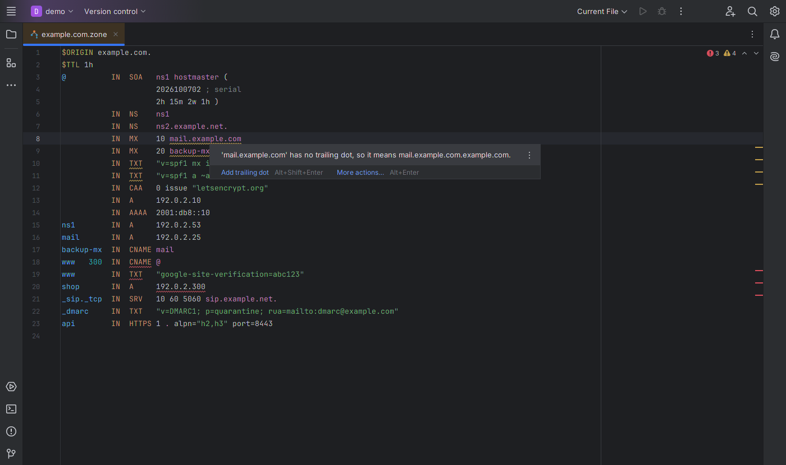
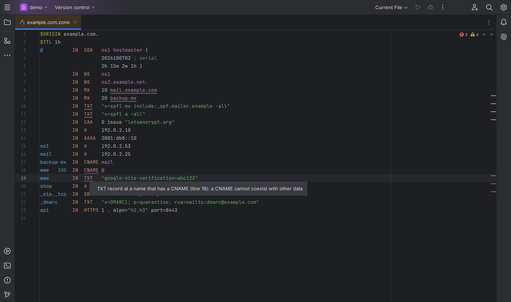
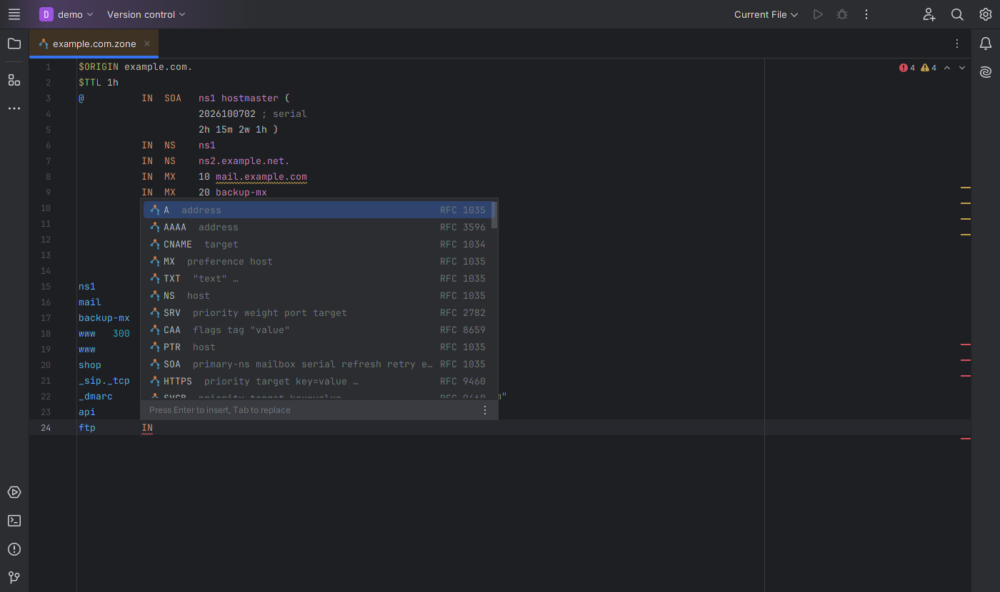
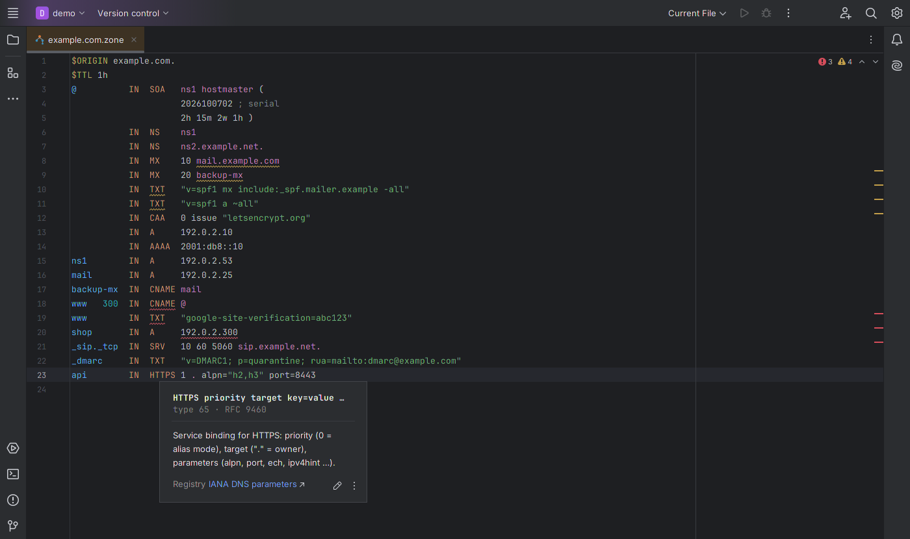
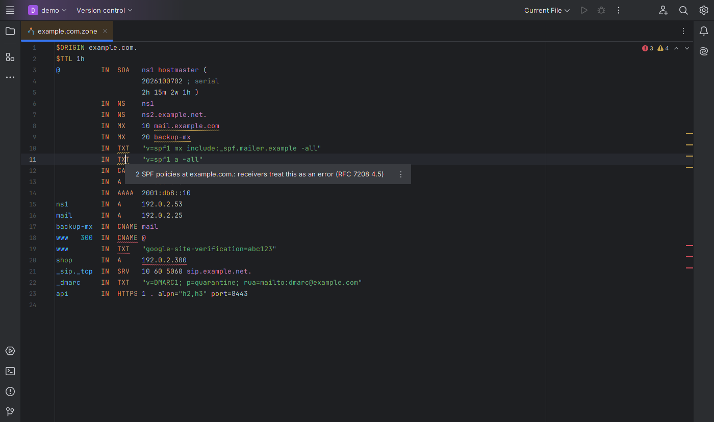

# DNS Zone File Tools — JetBrains IDE plugin

Support for **DNS zone files** (RFC 1035 master files as used by BIND, NSD, Knot DNS, PowerDNS and others) in IntelliJ
IDEA, PyCharm, GoLand, WebStorm and every other JetBrains IDE (2024.3 and newer). It catches the mistakes that break a
zone — or silently do the wrong thing — before you reload the name server.

Install: *Settings → Plugins → Marketplace → search "DNS Zone"*.

## Features
- **Record data validation for 70+ record types**: IPv4/IPv6 addresses, numbers and ranges, TTL units (`1h30m`),
  character strings over 255 bytes, base64/hex data (DNSKEY, DS, TLSA, SSHFP …), SVCB/HTTPS parameters (`alpn`, `port`,
  `ipv4hint` …, AliasMode), CAA, NAPTR, URI, RRSIG timestamps, the generic `\# len hex` syntax, unbalanced parentheses,
  unknown record types and directives, `$GENERATE` ranges and modifiers
- **Missing trailing dot**: `MX 10 mail.example.com` inside `example.com.` really means `mail.example.com.example.com.`
  — reported with quick fixes (add the dot, or shorten the name to `mail`)
- **Zone checks**: CNAME next to other data or several CNAMEs, MX/NS/SRV targets that are aliases or IP addresses,
  records outside the zone, in-zone name servers without glue, SOA not at the apex, missing TTL, different TTLs within
  one RRset, duplicate records (quick fix: delete)
- **E-mail authentication**: several SPF policies on one name, unknown SPF mechanisms (`–all` with an en dash …),
  more than 10 DNS lookups, `+all`, the obsolete SPF record type (quick fix: change to TXT), DMARC syntax
- **Naming and DNSSEC hints**: `_service._proto` owners for SRV, `_port._proto` for TLSA, CAA tags and flags, wildcard
  position, NSEC3 iterations and salt (RFC 9276), DNSSEC algorithms and SHA-1 DS digests that RFC 8624 rules out
- **Reformat Code**: owner, TTL, class, type and data lined up in columns (spaces or tabs, following the file); only whitespace changes
- **Update SOA serial** intention (Alt+Enter on the SOA record): date serials `YYYYMMDDnn` jump to today, others +1
- **Completion** of record types (with their fields), classes, directives, CAA tags, SvcParam keys, DNSSEC algorithms
  and of the names defined in the zone
- **Navigation**: Ctrl+click on a CNAME/MX/NS/SRV/PTR target jumps to its records
- **Quick documentation** (Ctrl+Q) for every record type and directive, TTLs in readable form (`86400` = 1d)
- Syntax highlighting with configurable colors, folding of multi-line records, commenting with `;`

## Which files?
`*.zone` files open automatically. Files such as `db.example.com`, `example.com.db`, `named.root` or
`2.0.192.in-addr.arpa.rev` are recognized by their content (SOA record, `$ORIGIN`/`$TTL`). For any other name: *Settings
→ Editor → File Types → DNS Zone File → add a pattern*.

The zone origin is taken from `$ORIGIN`, from an absolute SOA owner, or from the file name (`db.example.com` →
`example.com.`). Checks that need a certain origin (records outside the zone, SOA position) only run when the origin is
stated in the file.

## How it was tested
- Compared with a reference parser (dnspython): on 1,376 zone files from the test suites of BIND, Knot DNS, NSD and
  ldns, the plugin gives the same valid/invalid verdict for 97 % of the files. Almost all differences are record types
  dnspython cannot parse in text form (A6, NXT, WKS, MINFO …) or test files that BIND rejects and only the plugin flags.
- BIND's own `checkzone` test zones: none of the `good-*` zones is flagged; 115 of 130 labelled files get the same
  verdict as BIND (the rest need cryptographic DS/DNSKEY checks or RPZ/DNS-SD semantics).
- 72 realistic zones from PowerDNS and dnscontrol test data with all inspections enabled, plus 280+ randomly broken
  variants (no exceptions).

## More Klardaten plugins

- [HAProxy Config](https://github.com/klardaten-dev/haproxy-config) — HAProxy configuration: completion, navigation, 6 inspections, docs from the HAProxy manuals
- [VCL Language Tools](https://github.com/klardaten-dev/vcl-language-tools) — Varnish and Fastly VCL: completion, cross-file navigation, 8 inspections
- [Puppet Manifest Tools](https://github.com/klardaten-dev/puppet-manifest-tools) — Puppet manifests: Puppet 8 legacy-fact fixer, attribute checks, completion
- [PromQL and Prometheus Rules](https://github.com/klardaten-dev/promql-tools) — PromQL inside .promql and Prometheus rule files, checked like Prometheus itself

## Source code
The plugin is closed source (free to use under the EULA); this repository hosts its documentation, license and issue
tracker.

## Support
Please open an [issue](../../issues) for bugs and feature requests. Include your IDE version and a minimal zone snippet
(replace real names and addresses with `example.com` / `192.0.2.x` first).

## Privacy
The plugin works fully offline and collects no data. See [PRIVACY.md](PRIVACY.md).

## License
Free to use under the [End User License Agreement](EULA.md).

---
Independent project, not affiliated with ISC (BIND), NLnet Labs (NSD), CZ.NIC (Knot DNS) or PowerDNS.
